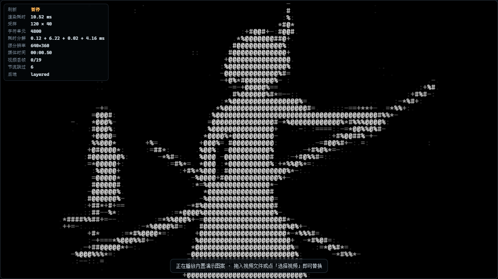

# ASCII ART VIDEO PLAYER — 网页字符画视频播放器

上传一个视频，网页把它逐帧变成 **ASCII 字符画**播放出来：视频解码 → 缩放采样 → 亮度映射 → 字符刷新。

```
┌──────────┐   ┌──────────────┐   ┌─────────────────┐   ┌──────────────┐
│ 视频解码  │ → │ 缩放到字符网格 │ → │ 亮度 → 字符映射  │ → │ 双缓冲刷新    │
│ <video>  │   │ 120 × 40     │   │ Y=0.299R+…      │   │ 30fps 真彩色  │
└──────────┘   └──────────────┘   └─────────────────┘   └──────────────┘
```



---

## 快速开始

**双击 `start.cmd`**（或手动执行 `node serve.mjs`），浏览器打开 <http://localhost:8080> 即可。

> ⚠️ **不要直接双击 `index.html`。** 浏览器在 `file://` 下会拦截 ES 模块加载，
> 并且禁止 canvas 读取视频像素（画布污染）。页面检测到这种打开方式时会给出提示横幅。
> 需要一个本地服务器，`serve.mjs` 是零依赖的（还支持 HTTP Range，视频才能拖进度条）。

没有视频也能看效果：页面启动后默认播放**内置合成演示图案**（渐变背景 + 灰阶台阶 + 运动亮球），
它同样走完整的字符化流水线。

## 操作

| 操作 | 说明 |
| --- | --- |
| 拖放视频到画面 / 「选择视频」 | 载入本地视频 |
| 右侧「输入源 → 视频网址」 | 直接从 URL 载入 |
| 空格 | 播放 / 暂停 |
| ← → | 后退 / 前进 5 秒 |
| Shift + ← → | 单帧步进（逐帧看字符画） |
| ↑ ↓ / M | 音量 / 静音 |
| H | 显示 / 隐藏左上角状态栏（等同「刷新与性能 → 显示 HUD 状态」） |
| F / S / C / D | 全屏 / 截图 / 复制字符帧 / 内置演示 |
| 1 – 5 | 切换网格预设 |

面板里可以调：网格列数与行数、字符宽高比、字符集（经典 10 级 / 细密 69 级 / 方块 / 明暗阶 / 自定义）、
反相、亮度、对比度、伽马、颜色模式（真彩色 / 灰度 / 单色）、缩放方式、渲染后端、目标帧率。

## 流水线是怎么实现的

### 1. 视频解码
用浏览器媒体栈（`HTMLVideoElement`）解码，`drawImage` 取当前帧。这样 mp4/H.264、webm/VP8/VP9 等
浏览器原生支持的格式都能播，**不需要在本地装 FFmpeg**——解码器和硬件加速都交给浏览器。
（仓库里的 `tools/make-fixtures.mjs` 仍会用 FFmpeg 生成测试素材；如果你的视频是浏览器不认的编码，
可以先用它或 `ffmpeg -i in.mkv -c:v libx264 -movflags +faststart out.mp4` 转一道。）

### 2. 缩放采样
把当前帧 `drawImage` 进一个 **cols × rows 的离屏画布**（例如 120×40 = 4800 个采样点），
浏览器负责滤波。大比例缩小（4K → 120 列）时会先降到 3 倍网格的中间画布，再做第二级缩放，
避免一步缩小丢细节。

### 3. 亮度 → 字符
对每个采样点按 **ITU-R BT.601** 算亮度，再按字符集从暗到亮取字形：

```
Y = 0.299R + 0.587G + 0.114B        // 0…255
index = round(Y / 255 × (字符数 - 1))
字符集 = " .:-=+*#%@"                // index 0 = 空格（最暗），9 = '@'（最亮）
```

亮度和对比度/伽马用一张 256 项的查找表实现（逐通道），颜色取自同一像素，
所以暗块是空格、亮块是 `@` 并保留原始色相。可选颜色模式：24 位真彩色 / 灰度 / 单色终端绿。

### 4. 输出与刷新
画布渲染提供两条路径，都消费同一份 `frameBuffer`（字符索引 + 打包颜色）：

| 后端 | 做法 | 120×40 绘制耗时 |
| --- | --- | --- |
| **分层合成**（默认） | ① `putImageData` 在 cols×rows 画布上做出「每格一像素」的颜色层 → ② 关闭插值放大到主画布，每格成为一块纯色 → ③ 另一张画布黑底白字画字形（`fillStyle` 恒定）→ ④ `multiply` 合成 | **1.41 ms** |
| 逐格直绘（基线） | 每个格子改一次 `fillStyle` + `fillText` | 2.29 ms |
| DOM 文本 | 维护 `<pre>` 的 `textContent`，真正的字符输出，可选中复制（单色） | 0.04 ms |

分层合成把 N 次状态切换压成一次恒定样式的绘制，代价是两次全画布 `drawImage`。
字形层用的是带 alpha 的画布：不透明画布会让浏览器启用 LCD 亚像素抗锯齿，
白字边缘会出现红/青彩边，乘上颜色层后就是明显的彩色描边。

帧循环由 **`requestAnimationFrame` + 目标帧率的理想截止时刻**驱动，`requestVideoFrameCallback`
只用来记录解码帧到达与精确媒体时间。为什么不把重绘挂在 rVFC 上：浏览器会合并 rVFC 回调
（实测有头模式下出现过「视频解码 59fps、rVFC 只回调 8fps」的情况），挂在上面画面就会跟着掉到 8fps。
另外节流要用「理想截止时刻」而不是「距上次渲染多久」——rAF 间隔（例如 75Hz 的 13.3ms）通常不是
目标帧周期（33.3ms）的整数倍，用差值判断会退化成每 3 个 tick 画一次，30fps 目标只剩 25fps。
掉帧时「自动性能调节」会按 15% 步长降列数，避免越卡越慢。

### 5. 音视频同步
音频由同一个 `<video>` 元素播放，**画面采样用的是同一个媒体元素、同一帧、同一个时钟**，
所以不存在音画漂移问题，也不需要额外做时间戳对齐。拖动进度条时会重置帧节流记录，
避免「往回拖之后画面卡住不刷新」。

### 6. 字符宽高比校正
终端/等宽字符不是正方形（宽 ≈ 0.6 × 高），直接按正方形网格采样会把画面纵向拉长。
所以行数由容器和字符比例推导：

```
rows = cols × (容器高 / 容器宽) × 字符宽高比
```

16:9 容器、120 列、实测步进比 0.586 → **39 行**（约等于常见的 120×40）。
页面启动时会用 `measureText` 实测当前字体的步进比作为默认值，也可以手动调。
缩放适配（完整显示 / 裁剪填满 / 拉伸）是在**显示空间**里算的——单元格不是正方形，
如果按「单元坐标」去 contain，黑边会留错位置、画面还会被压扁。

## 实测数据

测试环境：Windows + Edge，无头（软件解码）与有头（真实合成器）各跑一遍。

**640×360 @30fps 片源（`tests/fixtures/badapple-6s.mp4`）**

| 项目 | 无头 | 有头 |
| --- | --- | --- |
| 字符刷新率 120×40 | **30.0 fps** | **30.0 fps** |
| 字符刷新率 200×60 | 25.7 fps | **30.0 fps** |
| 渲染耗时 120×40 / 200×60 | 2.9 / 7.0 ms | 3.1 / 6.7 ms |
| 音画时钟漂移（4s） | −0.08 s | −0.07 s |
| 播放期间堆增长 | +2.7 / +5.4 MB | +2.7 / +5.5 MB |

**工作区原始素材，4K 60fps / 123.6 MB / 232s / moov 在文件尾部（有头）**

| 项目 | 结果 |
| --- | --- |
| 字符刷新率 120×40 | **30.2 fps**（渲染 5.9ms/帧） |
| 字符刷新率 200×60 | 13 – 25 fps（渲染 10 – 11ms/帧，波动大） |
| 拖动进度条定位 | 30 – 180 ms |
| 元数据就绪 | 0.1 – 0.2 s（Range 分片，moov 在尾部也能立刻播） |
| 解码器丢弃帧 | **149/297、178/298 —— 这台机器软件解码 4K60 跟不上**，刷新率受限于片源解码而非字符渲染 |
| 音画时钟漂移（5s） | −0.07 s |

**静态逐帧渲染（排除播放节流，1280×720 画布）**

| 网格 | 端到端 | 其中绘制 | 30fps 预算 |
| --- | --- | --- | --- |
| 120×40（4800 单元） | 2.99 ms | 1.41 ms | 33.3 ms |
| 200×60（12000 单元） | 6.33 ms | ~3 ms | 33.3 ms |
| 240×72（17280 单元） | 8.5 ms | 5.03 ms | 33.3 ms |

耗时分解（120×40）：采样 2.2ms + 读回 2.0ms + 亮度映射 0.03ms + 绘制 2.3ms——
**瓶颈是 `getImageData` 的 GPU→CPU 读回，不是字符绘制**。同类后端对比：120×40 绘制
分层合成 1.41ms vs 逐格直绘 2.29ms，240×72 是 5.03ms vs 8.81ms。


## 目录结构

```
index.html               页面与全部控件
src/ascii-core.js        纯计算层：亮度公式 / 字符映射 / 网格几何 / ANSI 导出（无 DOM，可单测）
src/renderers.js         三种输出后端：分层合成 / 逐格直绘 / DOM 文本
src/sources.js           帧来源：VideoSource（真实视频）、SyntheticSource（合成演示）
src/app.js               装配：控件绑定、帧循环、性能自适应、测试 API
src/style.css            终端风格 UI
serve.mjs                零依赖静态服务器（支持 Range，视频可拖进度）
start.cmd                Windows 一键启动
tools/make-fixtures.mjs  用 FFmpeg 生成测试素材与参考帧
tests/unit.test.mjs      18 项纯算法单元测试
tests/e2e.mjs            98 项真浏览器端到端测试（CDP 驱动无头 Edge）
tools/verify-video.mjs   用任意本地视频跑一遍全流程（定位 / 播放 / 截图 / 音画时钟 / 内存）
tools/measure-pitch.py   量截图里字符的排列周期，核对画面内容与状态栏声明是否一致
tests/out/               测试截图与报告
```

## 测试

```bash
node --test tests/unit.test.mjs     # 18 项：亮度公式、映射单调性、网格比例、颜色模式、ANSI 导出
node tests/e2e.mjs                  # 98 项：真浏览器端到端（自动起服务器 + 无头 Edge）
node tools/verify-video.mjs         # 用工作区里的真实视频跑一遍全流程（可带路径 / --headed / --play）
node tools/make-fixtures.mjs        # 重新生成测试素材（需要 ffmpeg）
```

端到端测试用 **CDP（DevTools Protocol）** 直接驱动无头 Edge，只依赖 Node 内置的 `WebSocket`，
不需要 puppeteer/playwright。覆盖内容：

- 默认网格、字符步进比、单元格宽高比校正
- **本地文件上传**（`input[type=file]` → `blob:` URL，含 123.6MB 的 4K 源文件）与 blob 释放
- 合成图案的灰阶条字符索引单调性
- 真实 H.264 解码：黑/灰/白三条竖带 → 正确映射到 `空格 / + / @`，真彩色保留
- 水平灰阶渐变的映射单调性
- `contain / cover / stretch` 三种适配的几何正确性与黑边位置
- Bad Apple 真实片段在多个时间点的渲染、字符种类与暗部占比
- 三种后端的性能对比与耗时分解、240×72 压力测试
- 实际播放刷新率、音频轨解码、媒体时间推进（同步）
- 反相、字符集切换、自定义字符集、颜色模式一致性
- 窗口尺寸变化后的网格重算
- 导出（PNG 截图 / 字符帧 / ANSI 真彩色）
- 传输控制条：时间显示随播放更新且与 `currentTime` 一致、进度条前进、倍速真的生效（含合成图案）
- **全部 37 个可见控件的配色与 WCAG 对比度审计**（防止控件退回浏览器默认白底黑字）
- 键盘快捷键（空格 / ←→ / M / H / 数字预设 / D）、拖放载入、帮助对话框、音量、播完回到 ▶
- 状态栏显示与隐藏：复选框生效、隐藏期间不刷新、**恢复时内容立即跟上当前网格**（HUD 节流不能丢最后一次更新）
- 拖动进度条时不被 `timeupdate` 抢回
- `file://` 打开时给出明确提示而不是静默失败
- 页面无未捕获异常

测试会把截图写到 `tests/out/`，可以和 `tests/fixtures/reference-*.png`（FFmpeg 抽出的原始画面）对照着看。

## 更深入的用法

页面暴露了一个调试/自动化 API：

```js
__ASCII__.setOptions({ cols: 160, rows: 48, colorMode: 'mono', engine: 'layered' });
await __ASCII__.loadUrl('/my-video.mp4');
await __ASCII__.seek(12.5);
__ASCII__.renderOnce();
console.log(__ASCII__.getFrameText());   // 当前帧的字符画
console.log(__ASCII__.getFrameAnsi());   // 24 位真彩色 ANSI，可直接粘进终端
```

## 已知限制

- **观感是动态字符画，不是高清视频**：120×40 时每个字符代表 16×27 个原始像素，细节必然丢失。
  提高列数能变清晰，但字符单元数和渲染耗时会同步上升。
- **解码能力取决于浏览器**：H.264/AAC、VP8/VP9、AV1 一般没问题；HEVC、部分 MKV 变体可能不支持，
  先用 FFmpeg 转成 H.264 MP4 最稳。
- 浏览器必须允许读取画布像素，所以**必须走本地服务器**（`file://` 会被拒绝）。
- `getImageData` 是 CPU 读回，是当前的性能瓶颈；再往上优化需要走 WebGL/WebGPU 着色器路径。
- DOM 文本后端只支持单色（每格一个 `<span>` 在 30fps 下不现实）。
